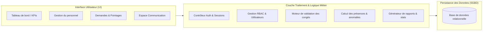
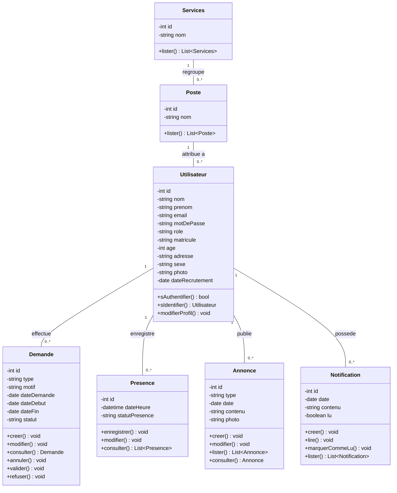
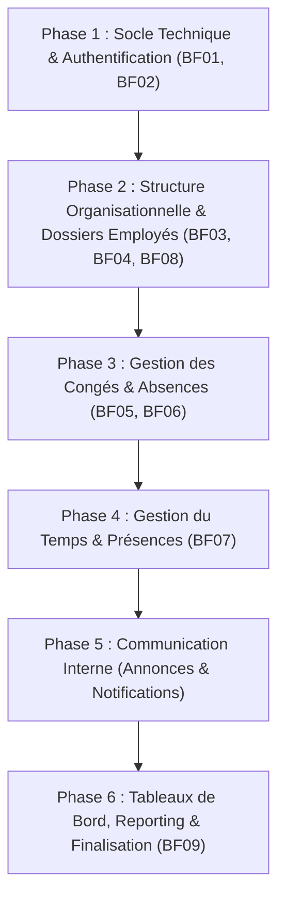

Ce document constitue la feuille de route (**Roadmap**) et le référentiel fonctionnel complet pour le développement de l'application web de gestion des ressources humaines, basé sur l'analyse intégrale des spécifications du projet (**Mémoire de Sheilla**, diagrammes UML, dictionnaire de données et maquettes d'interface).

---

## 1. Présentation Générale du Projet

* **Organisation cible** : JIRAMA Antsirabe (Jiro sy Rano Malagasy)
* **Type d'application** : Application Web de Gestion des Ressources Humaines (3-tiers)
* **Objectif principal** : Centraliser, automatiser et sécuriser la gestion administrative du personnel, le suivi des présences, la dématérialisation des demandes de congés/absences et la communication interne.

---

## 2. Profils d'Utilisateurs & Matrice des Droits (RBAC)

L'application intègre trois rôles distincts définis dans les cas d'utilisation :

| Acteur / Rôle | Responsabilités & Périmètre fonctionnel |
| :--- | :--- |
| **Administrateur** | • Gestion intégrale des comptes utilisateurs et attributions des rôles • Activation / désactivation des comptes • Configuration et sécurisation des paramètres du système • Consultation des tableaux de bord généraux |
| **Responsable RH** | • Gestion complète des dossiers du personnel (création, modification, consultation, désactivation) • Configuration de l'organisation (Services et Postes) • Traitement des demandes d'absence et de congés (validation, refus justifié) • Suivi quotidien et historique des présences (pointages, retards, anomalies) • Publication et gestion des annonces d'entreprise • Consultation approfondie des tableaux de bord, statistiques et export de rapports |
| **Employé** | • Accès à son espace personnel sécurisé • Consultation de sa propre fiche et mise à jour de son profil • Soumission de demandes de congé ou d'absence avec pièces justificatives • Suivi en temps réel de l'état de ses demandes • Consultation des annonces internes et des notifications personnelles |

---

## 3. Matrice des Besoins Fonctionnels Officiels

Conformément au tableau des spécifications du mémoire (*Tableau 2.09*) :

| Code | Intitulé du besoin | Description détaillée |
| :--- | :--- | :--- |
| **BF01** | **Se connecter avec un compte sécurisé** | Authentification par identifiant unique / e-mail et mot de passe, persistance de session sécurisée, déconnexion. |
| **BF02** | **Gérer les rôles et les droits d'accès** | Contrôle d'accès basé sur les rôles (RBAC) protégeant chaque route, page et action de l'application. |
| **BF03** | **Ajouter, modifier, rechercher et désactiver un employé** | Cycle de vie complet du dossier employé avec conservation de l'historique lors de la désactivation. |
| **BF04** | **Gérer les services et les postes** | Structuration de l'organigramme de la JIRAMA (Directions/Services et postes associés). |
| **BF05** | **Soumettre une demande de congé ou d'absence** | Formulaire de demande par l'employé avec dates (début/fin), type d'absence, motif et justificatif. |
| **BF06** | **Accepter ou refuser une demande** | Workflow de décision réservé aux RH avec obligation de motif pour tout refus. |
| **BF07** | **Enregistrer et consulter les présences et absences** | Horodatage des entrées/sorties, détection automatique des retards et absences non justifiées. |
| **BF08** | **Rechercher les informations multi-critères** | Recherche rapide par matricule, nom, prénom, service ou poste. |
| **BF09** | **Consulter rapports, notifications et tableaux de bord** | Visualisation des indicateurs clés (KPIs), graphiques d'évolution, alertes et export des états. |

---

## 4. Spécification Détaillée des Modules Fonctionnels

### 4.1 Module Authentification & Gestion des Comptes (BF01, BF02)
- [ ] **Écran de connexion** : Interface épurée avec saisie de l'e-mail et du mot de passe (conforme à la maquette).
- [ ] **Gestion des sessions** : Tokens sécurisés / cookies HTTP-only, expiration automatique après inactivité.
- [ ] **Gestion du mot de passe oublié** : Lien et procédure de réinitialisation sécurisée.
- [ ] **Sécurité d'accès** : Blocage immédiat des accès pour les comptes désactivés.
- [ ] **Règles d'association** : Un compte utilisateur est strictement associé à un seul dossier employé (règle 1:1).

### 4.2 Module Organisation : Services & Postes (BF04)
- [ ] **Gestion des Services** : CRUD des départements (ex: Service Distribution, Service Production, Service Administratif & Financier, etc.).
- [ ] **Gestion des Postes** : CRUD des métiers/postes (ex: Plombier, Électricien, Monteur de ligne, Médecin d'entreprise, Releveur de compte, Gestionnaire financier, etc.).
- [ ] **Liaison hiérarchique** : Association d'un poste à son service d'appartenance.

### 4.3 Module Gestion Administrative du Personnel (BF03, BF08)
- [ ] **Liste des employés sous format cartes / grille** (conforme à la maquette) :
  - Affichage photo, nom, prénom, intitulé du poste.
  - Actions rapides : Bouton "Modifier" et bouton "Supprimer" (désactivation logique).
- [ ] **Fiche détaillée employé** :
  - Données d'état civil : Matricule (unique), Nom, Prénom, Sexe, Âge, Adresse personnelle, Photo.
  - Données professionnelles : Service, Poste, Date de recrutement, Statut du compte (actif/inactif).
- [ ] **Barre de recherche rapide & filtres** : Recherche en direct par matricule, nom, prénom, service ou poste.
- [ ] **Cycle de vie & Conservation** : Soft-delete pour désactiver sans détruire l'historique contractuel et administratif.

### 4.4 Module Congés & Autorisations d'Absence (BF05, BF06)
- [ ] **Formulaire de demande de congé/absence** (espace employé) :
  - Sélection du type (congé annuel, maladie, autorisation exceptionnelle, maternité/paternité, etc.).
  - Sélection de la période : Date de début, Date de fin (calcul automatique de la durée).
  - Motif de la demande et champ de téléversement pour justificatif (certificat médical, convocation).
- [ ] **Espace de traitement RH** :
  - Liste filtrable par statut (`En attente`, `Validée`, `Refusée`, `Annulée`).
  - Actions : Valider la demande, ou Refuser avec saisie obligatoire du motif de refus.
  - Historique complet des décisions horodatées.

### 4.5 Module Présences & Pointage (BF07)
- [ ] **Enregistrement des présences** : Saisie ou import des pointages d'entrée et de sortie (dateHeure).
- [ ] **Suivi des statuts** : `Présent`, `Absent`, `Retard`, `Anomalie de pointage`.
- [ ] **Prise en charge des horaires postés** : Adaptation aux équipes de terrain JIRAMA (rotations de travail et astreintes).
- [ ] **Feuille de présence & Historique** : Consultation individuelle et collective sur une période sélectionnée.

### 4.6 Module Communication : Annonces & Notifications
- [ ] **Publication d'annonces (RH)** : Rédaction d'une annonce avec titre/type, date, texte descriptif et photo/image jointe.
- [ ] **Fil d'annonces (tous employés)** : Consultation des actualités internes et notes de service.
- [ ] **Centre de notifications** : Notifications automatiques pour chaque événement (validation/refus de congé, nouvelle annonce) avec suivi de lecture (`lu : boolean`).

### 4.7 Module Tableaux de Bord & Reporting (BF09)
- [ ] **Indicateurs Clés (KPIs Cards)** :
  1. **Nombre total des employés** : Effectif actif enregistré sur la plateforme.
  2. **Demandes en attente** : Nombre de requêtes nécessitant une action du RH.
  3. **Taux de présence moyen** : Pourcentage global d'assiduité sur la période.
  4. **Nombre de services et postes** : Couverture organisationnelle répertoriée.
- [ ] **Graphiques décisionnels** :
  - **Évolution mensuelle** : Bar-chart comparatif (Effectif total vs Demandes reçues par mois).
  - **Taux de présence** : Donut-chart (Présents vs Absents avec taux moyen au centre).
- [ ] **Rapports & Exports** : Génération et exportation des états (PDF / Excel) des présences, congés et effectifs.

---

## 5. Dictionnaire et Modèle de Données

### Schéma Entités / Relations (Mermaid)

---

## 6. Règles de Gestion Métier (RG)

* **RG01 (Matricule unique)** : Chaque employé possède un numéro matricule strictement unique au sein de la JIRAMA.
* **RG02 (Unicité de compte)** : Un compte utilisateur ne peut être rattaché qu'à un unique dossier employé (sauf comptes techniques d'administration).
* **RG03 (Intégrité des demandes)** : Toute demande de congé doit obligatoirement comporter une date de début, une date de fin valide ($dateDebut \le dateFin$) et un motif explicite.
* **RG04 (Workflow strict des congés)** : Une demande passe par l'état `En attente` avant d'être `Validée` ou `Refusée`. Une demande en attente n'octroie aucun droit d'absence immédiat.
* **RG05 (Motivation des refus)** : Tout refus de demande de congé ou d'autorisation d'absence doit obligatoirement être accompagné d'un motif explicatif.
* **RG06 (Conservation et Soft Delete)** : La désactivation du compte d'un employé ne supprime en aucun cas son historique de présence, de demandes ou d'activité administrative. La suppression physique est strictement encadrée.
* **RG07 (Cloisonnement des accès)** : Un employé ne peut consulter et modifier que les données de son propre profil personnel. Seul le Responsable RH a accès à la modification des données professionnelles et contractuelles.
* **RG08 (Traçabilité & Audit Trail)** : Toute opération sensible (création d'utilisateur, changement de rôle, validation/refus de congé) est tracée avec identifiant utilisateur, date et nature de l'action.

---

## 7. Roadmap de Réalisation Progressive

Conformément à la stratégie de mise en œuvre préconisée dans le mémoire (*Section 2.8.1 Développement progressif*), le développement s'articule en **6 phases successives** :

### Phase 1 : Socle Technique, Authentification & Contrôle d'Accès
> **Objectif** : Mettre en place l'environnement, la base de données et l'accès sécurisé par rôle.
- [ ] Initialisation de la structure du projet (Frontend, Backend, BDD)
- [ ] Implémentation du schéma de base de données (tables `Utilisateur`, `Role`)
- [ ] Page d'authentification (UI Login conforme à la maquette)
- [ ] Logique d'authentification, gestion des tokens/sessions et hachage des mots de passe
- [ ] Middleware / Guard RBAC (protection des routes selon Administrateur / Responsable RH / Employé)
- [ ] Module d'administration des utilisateurs (création de compte, activation/désactivation)

### Phase 2 : Organisation & Gestion du Personnel
> **Objectif** : Gérer l'organigramme (Services & Postes) et le référentiel des employés.
- [ ] CRUD des Services et des Postes
- [ ] Interface de gestion des employés (vue en grille de cartes d'employés)
- [ ] Formulaire d'ajout et de modification d'employé avec upload photo
- [ ] Moteur de recherche multi-critères (nom, matricule, service, poste)
- [ ] Mécanisme de désactivation logique (soft-delete) et conservation de l'historique

### Phase 3 : Dématérialisation des Congés & Absences
> **Objectif** : Permettre aux agents de soumettre des demandes et aux RH de les instruire.
- [ ] Formulaire de demande de congé côté employé avec upload de justificatif
- [ ] Dashboard RH de suivi des demandes en temps réel
- [ ] Modal de validation / refus avec obligation de saisir un motif de rejet
- [ ] Historique des demandes par employé et calcul des durées

### Phase 4 : Gestion du Temps, Pointage & Présences
> **Objectif** : Tracer l'assiduité et détecter les anomalies.
- [ ] Interface d'enregistrement et d'émargement des pointages (entrées/sorties)
- [ ] Détection et marquage des retards et absences injustifiées
- [ ] Consultation des feuilles de présence par employé, service ou date
- [ ] Gestion des plannings et roulements pour les agents techniques

### Phase 5 : Communication Interne & Notifications
> **Objectif** : Diffuser les annonces de la JIRAMA et notifier les utilisateurs des décisions.
- [ ] Module de publication d'annonces RH (texte + image)
- [ ] Affichage du flux d'annonces sur l'espace collaborateur
- [ ] Système d'alerte et notifications internes (notif de validation de congé, nouvelles annonces)
- [ ] Gestion du statut des notifications (lu / non lu)

### Phase 6 : Tableaux de Bord, Reporting & Recette
> **Objectif** : Fournir une vision décisionnelle claire et clôturer le déploiement.
- [ ] Conception du Tableau de bord RH (conforme aux maquettes) :
  - Compteurs KPI (Effectif total, Demandes en attente, Taux de présence %, Services/Postes)
  - Graphique bar-chart mensuel (effectif vs demandes)
  - Graphique donut (taux moyen de présence)
- [ ] Module d'exportation de rapports de présence et de bilans RH
- [ ] Tests fonctionnels d'intégration et recette utilisateur
- [ ] Déploiement et documentation de remise de projet
